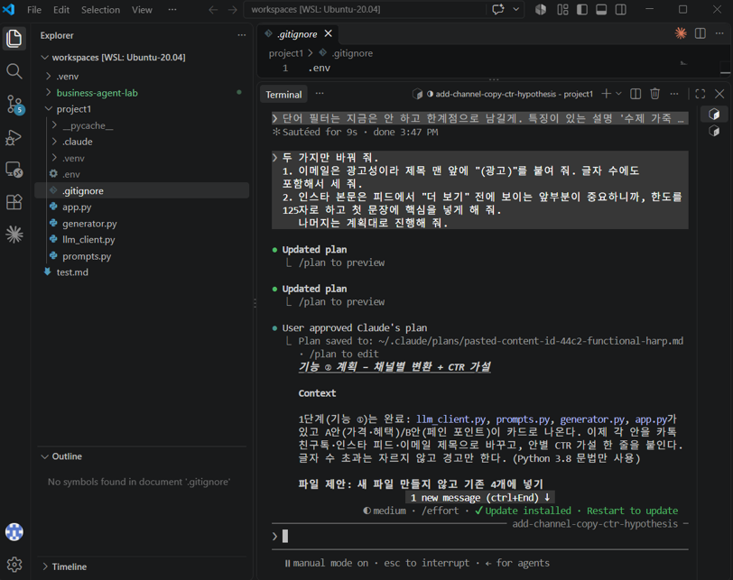
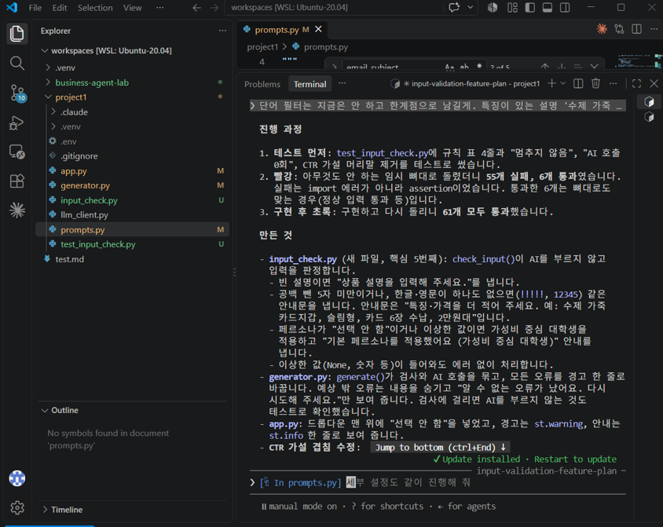
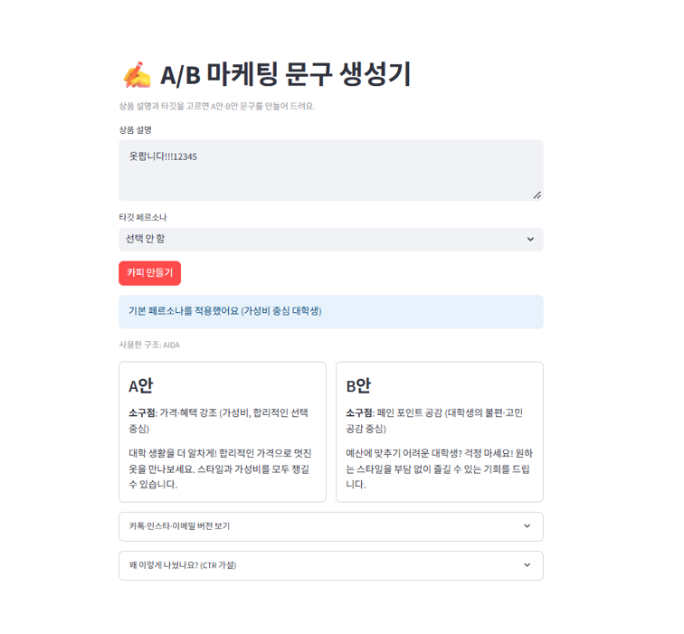
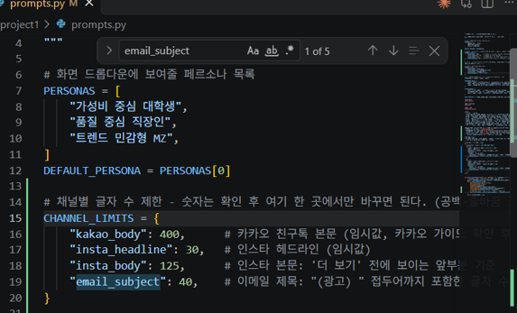
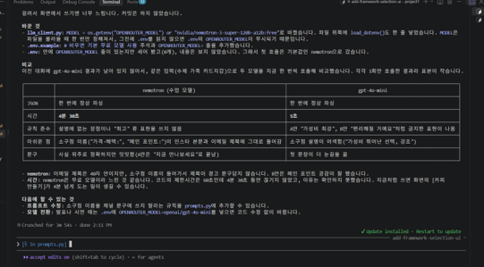
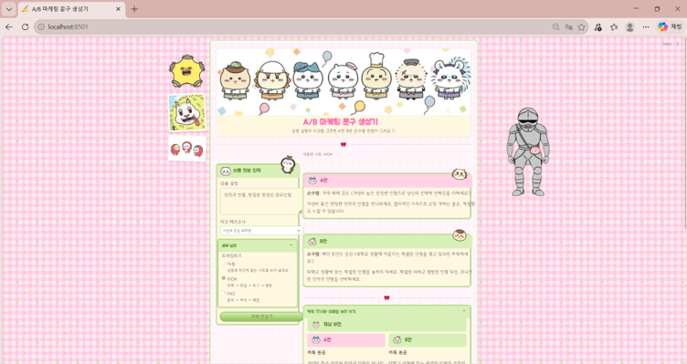

# A/B 마케팅 문구 생성기

배포 주소: https://project1-9wrbt6r2wpl8jengscbhep.streamlit.app/ (오래 안 쓰면 앱이 잠들어서, 열었을 때 "get this app back up" 버튼이 나오면 누르고 1분 정도 기다리면 된다)

## 1) 목적과 사용자

상품 설명과 타깃 페르소나를 입력하면 A/B 테스트용 마케팅 문구 2안을 만들어 주는 Streamlit 앱이다.
마케팅 전담 인력이 없는 소규모 쇼핑몰 셀러가 사용자이다.

## 2) 실행 방법

```bash
python -m venv .venv
source .venv/bin/activate
pip install -r requirements.txt
cp .env.example .env        # 열어서 OPENROUTER_API_KEY에 본인 키 입력
streamlit run app.py
pytest                      # 테스트 실행 — 테스트 108개 통과 (2026-10-20 직접 실행해서 확인)
```

- `OPENROUTER_API_KEY`: OpenRouter에서 발급받은 키를 `.env`에만 적는다. 커밋하지 않는다.
- `OPENROUTER_MODEL`: 사용할 OpenRouter 모델 ID이다. 비워 두면 기본 무료 모델(`nvidia/nemotron-3-super-120b-a12b:free`)을 쓴다. `openai/gpt-4o-mini`를 추천한다 (무료 모델은 느리고 OpenRouter에서 사라질 수 있음).

## 3) 주요 기능 3가지

1. **A/B 2안 생성**: A안은 가격·혜택, B안은 페인 포인트 공감으로 소구점을 고정하고, 두 안 모두 2~3문장으로 쓴다.
2. **채널별 버전과 글자 수 검사**: 카톡 본문, 인스타 헤드라인·본문, 이메일 제목을 함께 만들고 글자 수를 보여준다. 한도를 넘으면 자르지 않고 경고만 한다. 이메일 제목 앞의 "(광고) "는 코드가 붙인다.
3. **입력 검증과 세부 설정**: 설명이 너무 짧거나 기호뿐이거나 비어 있으면 AI를 부르지 않고 안내한다. 페르소나를 고르지 않으면 기본값이 적용된다. 프레임워크(자동/AIDA/PAS)를 고를 수 있고, 각 안의 CTR 가설도 보여준다.

## 4) 작업 과정

1. 기능 3개를 먼저 정의하고 1->2->3 순서로 만들었다.
2. GitHub에 Project1 저장소를 만들고 클로드에게 연결하게 시킨 후, 클로드에게 A/B 카피 에이전트 홈페이지 화면 초안을 설계하게 시켜 화면 설계도를 만들었다.
3. 클로드의 Plan 모드로 파일 구조 계획을 받은 뒤, 페르소나 목록, 입력 기준, 카카오톡 글자 수 등은 내 기준으로 바꿨다.
4. 기능1에서 A/B 문구 생성에서 먼저 OpenRouter 호출코드를 만들어 AI 응답이 나오는지 확인하고 첫 결과를 보니 A안과 B안의 내용이 비슷하고, 내가 입력하지 않은 내용과 특징을 지어내고 말투도 대학생 말투에 어울리지 않는 딱딱한 내용이었다. 그래서 클로드에게 “A안은 가격·혜택, B안은 고민/공감, 입력에 없는 내용은 쓰지 말 것”을 요청해 프롬프트를 고친뒤 Streamlit 화면을 붙여 A/B 카드가 나란히 나오게 했다.
5. 기능2에서는 만들어진 A안/B안을 카카오톡과 인스타그램, 이메일 제목 3가지로 채널별로 쓸 내용을 글자 수에 맞게 만들고 만들어진 메시지가 각각 어떤 클릭률 가설을 검증하는지 확인하였다. 클로드가 낸 계획을 그대로 사용하지 않고 광고 이메일 제목에는 (광고)표기, 인스타 본문은 “더보기”전 125자 기준으로 하도록 수정했다.
6. 기능3에서는 상황->동작 규칙을 먼저 정하고, 테스트를 먼저 쓰게 요청하였다. 테스트를 먼저 쓰고 빈 뼈대로 돌리니 61개중 55개가 실패였고 구현 후 61개가 모두 통과하였다. 다른 테스트는 다 통과했지만 직접 "옷팝니다!!!12345”를 넣어보니 AI가 없는 내용을 지어내어서 숫자·특수문자를 뺀 한글·영문 글자만 세도록 기능을 수정하였고 전체 71개 통과했다.
7. 화면 설계시 접어뒀던 세부설정에서 프레임워크 선택(자동/AIDA/PAS)만 넣기로 범위를 좁혀서 요청하였고 세부 설정에서 PAS를 고르면 AI 요청에 PAS 구조만 들어가고, 화면에도 "사용한 구조: PAS"로 표시되도록 설계해 78개의 테스트에 통과했다. 또한 임의로 설정해둔 카카오톡의 텍스트 수를 카카오톡 공식 가이드에서 확인 후 400자로 설정하였다. 그리고 수업 코드에서 쓴 모델 nvidia nemotron를 찾아 바꾸고, 이전 모델gpt-4o-mini과 결과·속도를 비교했고 nemotron은 규칙을 더 잘 지키지만 4분 30초, gpt-4o-mini는 5초지만 금지 표현이 나온다는 결과를 확인했다.
8. 참고 이미지를 주고 디자인을 요청하였고. 캐릭터 그림은 직접 배경을 제거하여 첨부 한 후 세부 디자인이나 아이콘 크기와 폰트 가독성을 다시 조정 후에 원하는 분위기로 만들었다. 처음엔 저작권 때문에 그림을 올리지 않았지만, 교수님께 확인한 뒤 과제용·비수익 표시를 하고 올렸다.
9. 클로드로는 README 작성을 위한 코드 확인 가능한 부분만 맡기고, 회고와 증거 부분은 직접 작성하도록 범위를 나눴다. 최종 테스트로 테스트 파일 5개, 108개 전부 통과한 것을 확인할 수 있었다.


## 5) Claude Code 활용 증거와 검증


1. 계획 수정 : Claude Code가 낸 계획을 그대로 사용하지 않고 광고 이메일 제목에 "(광고)" 표기, 인스타 본문은 "더 보기" 전 125자 기준으로 하도록 두 가지를 수정하였다. 
 


2. 테스트 먼저 : 구현 전에 테스트를 먼저 돌리니 61개 중 55개가 실패했고, 입력 검증을 구현한 뒤 같은 테스트가 모두 통과하였고 "옷팝니다", "!!!!!", 빈칸, 페르소나 미선택까지 확인하였다.
 


 3. 테스트는 통과했는데 직접 넣어본 "옷팝니다!!!12345"가 뚫림 : 테스트는 다 통과했지만, 직접 "옷팝니다!!!12345"를 넣어 보니 검사를 통과해 AI가 없는 
내용을 지어냈다. 그 후 숫자,특수문자를 뺀 실제 글자 수로 세도록 내용을 수정했다.
고친 뒤 같은 입력은 재입력 안내만 나왔고, 테스트 71개가 모두 통과했다.



 4. 한도를 일부러 10자로 줄여 경고가 맞게 뜨는지 확인 : 검증을 위해 이메일 한도를 일부러 40→10자로 줄였더니 "이메일 제목 3자 초과(13/10)" 경고가 떴다. 문구는 자르지 않고 경고만 표시했고 확인 후 40으로 다시 되돌렸다.



5. 모델비교 : 수업 모델 nemotron과 gpt-4o-mini를 같은 입력으로 비교했고 nemotron은 규칙을 더 잘 지키지만 4분 30초가 걸리고, gpt-4o-mini는 5초지만 금지 표현"최강"이 나왔다.
 


6. 최종화면 : 핑크 체크무늬 배경에, 치이카와 캐릭터 배너와 옆 장식,  A/B 문구 상자를 클로드 코드로 단계별 수정해 완성했다. 화면의 캐릭터 그림은 과제용이며 수익 목적이 없다.
 

## 6) 효과적이었던 방법 3가지

1. Plan 모드로 계획 먼저 확인하기
코드를 쓰기 전에 계획부터 확인해보고 이상한 부분을 미리 고칠 수 있었다. 그대로 승인했으면 이메일 (광고) 표기, 인스타 125자 기준을 놓쳤을 것이다.

2. 테스트 먼저 쓰기
기능 전에 "이렇게 동작해야 한다"를 테스트로 먼저 정했더니 55개 실패에서 61개 통과로 AI가 만든 코드가 맞는지 코드를 몰라도 숫자로 확인 할 수 있었다.

3. 직접 엉뚱한 입력 넣어보기
테스트가 통과해도 다시 직접 써봤더니 "옷팝니다!!!12345”라는 검사를 통과하는 구멍을 발견했다. 카톡 글자 수도 AI 말 대신 공식 가이드로 직접 확인했다.


## 7) 어려웠던 점 3가지

1. Python 버전 문제
내 컴퓨터가 Python 3.8이라 문법에 오류가 있었다. 에러 내용을 클로드에 보여주니 원인을 찾고 3.8에 맞게 고쳐줬다.

2. AI가 없는 내용을 지어냄
입력하지 않은 장점, 금기어 (완벽히,최강)를 사용하는 문제가 있었다. 프롬프트에 금지 규칙을 추가했고, 상품 설명을 자세히 쓰면 줄어들었다. 하지만 완전히 막을수는 없었다.

3. 모델 고르기
Nemotron는 규칙을 잘 지키지만 4분30초, gpt-4o-mini는 5초지만 규칙을 어겼다. 속도와 품질 중 하나를 골라야 했기 때문에 시연은 gpt-4o-mini로 하고 .env에서 바꿀 수 있게 하였다.


## 8) 한계점

- 무료 모델을 쓰므로 응답 품질과 속도가 모델과 OpenRouter 상태에 따라 달라진다.
- 인스타 헤드라인(30자)과 이메일 제목(40자) 한도는 임시값이다. 카톡 본문(400자)만 출처를 확인했다.
- 글자 수 한도는 프롬프트로 요청할 뿐 AI가 지킨다고 보장하지 못하며, 넘으면 경고만 표시한다.
- 상품 설명에 없는 사실을 지어내지 않는 규칙도 프롬프트로만 요청하고, 코드로 검증하지는 않는다.
- 결과는 저장하거나 내보낼 수 없고 화면 세션 동안만 유지된다.
- 화면 장식용 캐릭터 그림은 과제용이며 수익 목적이 없다.
- 직접 테스트하며 발견한 점:
  - AI가 입력에 없는 혜택이나 금지어("완벽히", "세련된", "최강")를 지어내기도 한다.
  - 가끔 영어 단어("bulky")가 섞이고, 말투가 페르소나보다 딱딱하다.
  - "USB 3.0"처럼 글자가 5개보다 적은 짧은 상품명은 너무 짧다고 막힌다.
  - 기본 무료 모델(nemotron)은 한 번에 약 4분 30초가 걸린다. gpt-4o-mini는 빠르지만 규칙을 더 자주 어긴다.
  - 테스트한 상품 수가 적어서 결과를 일반화하기 어렵다.

## 9) 핵심 소스 파일

| 파일 | 설명 |
|---|---|
| `app.py` | Streamlit 화면 흐름(입력, A/B 결과, 채널 버전, CTR 가설) |
| `generator.py` | `generate()`: 입력 검사 → AI 호출 → JSON 해석 → 글자 수 검사 |
| `prompts.py` | 프롬프트, 페르소나·프레임워크·채널 글자 수 한도 |
| `llm_client.py` | OpenRouter 호출, 모델·키 설정 |
| `input_check.py` | 입력 검증 규칙 |
